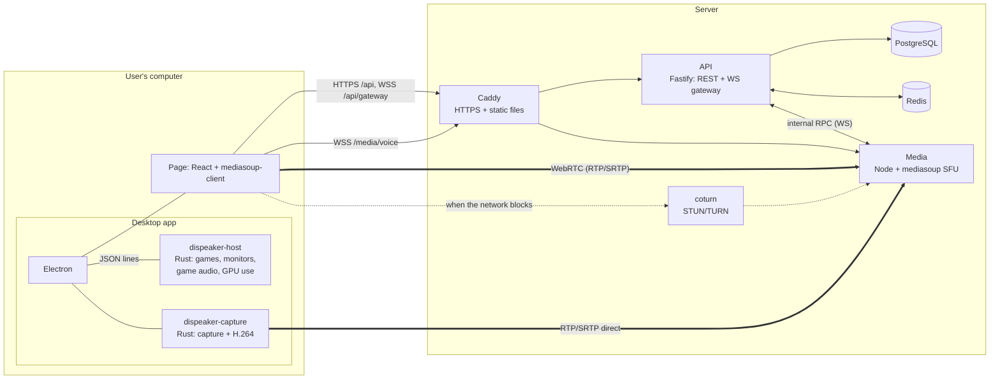

<div align="center">


# Dispeaker

**Voice, screen sharing and chat for a group of friends, on its own media server.**
Discord-style, with all of the realtime side written here: no LiveKit, Agora or Twilio.

[Versão em português](README.md) · [Architecture](docs/architecture.md) · [Decisions (ADRs)](docs/adr/README.md)

</div>

<br />


## About

Dispeaker was built for a group of friends who play together and wanted to hear and watch each other without depending on anyone. It has run on a self-hosted VPS since October 2026, in the browser and as a Windows app. The interface is in Brazilian Portuguese.

What sets it apart from a typical Discord clone is what sits under the interface. The media server is an SFU built on mediasoup; the realtime gateway, the signaling protocol and the desktop app's screen capture engine were written in the project itself. That is what makes it possible to stream a heavy full-screen game at 60 frames per second, and to measure, frame by frame, where a stream loses quality.

- Responsive web and a Windows desktop app, with the same account and the same interface.
- Self-hosted infrastructure: SFU, WebSocket gateway, TURN, Postgres and Redis, all in one `docker compose`.
- Invite-only sign-up with an access code.
- A "brutalist terminal" look: 1px-bordered panels, square corners and a single accent colour.

## Demo

<p align="center">
  
</p>

> Every picture in this README uses demo accounts with fictional data, on the local stack. The call, the stream and the numbers are real; only the camera, microphone and screen are synthetic.

## Features

### Voice and streaming

<table>
  <tr>
    <td width="50%"></td>
    <td width="50%"></td>
  </tr>
  <tr>
    <td align="center"><sub>Chat beside the call</sub></td>
    <td align="center"><sub>A stream's measurements</sub></td>
  </tr>
</table>

- **Voice channels** with mute, deafen (which really stops sending audio), speaking indicator, automatic reconnection, push to talk and per-person volume, kept in the account.
- **Neural noise suppression** in the browser (GTCRN in WebAssembly), with a filter of our own that restores the treble the model cuts. Opus voice at 128 kbps.
- **Screen sharing** in H.264 on the GPU, with three presets (720p30, 1080p60 and 1440p30 for films), sound at 256 kbps, several at once, full screen and picture-in-picture.
- **Watch on demand**: video only goes to those who clicked watch, and stops being sent when it leaves the screen.
- **Real statistics** on every stream (resolution, frames per second, bitrate, loss, codec) and in the bottom bar (RTT, upload, download).
- **Measured streams**: the streamer, the server and every viewer send samples every 5 seconds, and the page points to where along the path frames get lost.
- **Camera** with simulcast.

### Meetings by link

<p align="center">
  
</p>

<table>
  <tr>
    <td width="50%"></td>
    <td width="50%"></td>
  </tr>
  <tr>
    <td align="center"><sub>Arriving through the link</sub></td>
    <td align="center"><sub>Inside the meeting</sub></td>
  </tr>
</table>

- A Google Meet-style room outside any server: whoever has the link asks to join and someone inside lets them in.
- **Guests without an account**, with just a name.
- Voice, camera, screen sharing and chat. The host mutes for everyone, removes people and ends the meeting.
- The room lives only in Redis and disappears, chat included, two minutes after the call empties.

### Chat

<table>
  <tr>
    <td width="50%"></td>
    <td width="50%"></td>
  </tr>
  <tr>
    <td align="center"><sub>Replies, mentions, reactions and polls</sub></td>
    <td align="center"><sub>Pictures and files</sub></td>
  </tr>
</table>

- Editing, deleting, mentions, replies, reactions, polls, **threads** and typing indicators.
- Pasted, dropped or attached pictures; files of any type; link previews; optional GIF search.
- Attachments served with the channel's permissions: whoever cannot see the channel cannot open the file.
- Unread state per channel and cursor pagination.

### People and servers

<table>
  <tr>
    <td width="50%"></td>
    <td width="50%"></td>
  </tr>
  <tr>
    <td align="center"><sub>Private conversations</sub></td>
    <td align="center"><sub>Message request</sub></td>
  </tr>
</table>

- **Friends, private conversations and one-to-one calls**, with a ringtone.
- **Message requests** from people who share a server but are not friends, and **blocking**.
- **"Playing X"** next to the name of someone with a game open in the desktop app.
- **Servers, categories and numbered channels**, invites with expiry and use limits.
- **Roles and permissions** with hierarchy and per-channel overwrites, enforced on the server even during a call: losing the right to speak ends the voice session at once.
- Preferences (volumes, mutes, privacy) that follow the account across devices.

### Windows desktop app

<table>
  <tr>
    <td width="50%"></td>
    <td width="50%"></td>
  </tr>
  <tr>
    <td align="center"><sub>Download page</sub></td>
    <td align="center"><sub>Global shortcuts</sub></td>
  </tr>
</table>

- An Electron window onto the published site: whatever the site gains, the app gains without reinstalling.
- **60 fps streaming a full-screen game**, with a capture engine of its own in Rust (see [below](#streaming-a-game-at-60-fps)).
- **Global shortcuts** for mute, deafen, stream, camera and hang up that work with the game in focus. With a game in front, the stream shortcut streams that game without opening the picker.
- A stream's sound carries only the game, without the call or other programs.
- Detects the running game (Steam, Epic, Xbox, GOG and full-screen programs) with no external list and no internet.
- Microphone, sound and hang-up buttons on the taskbar thumbnail; a tray icon showing the call state.
- Automatic updates from the project's own server.

### On a phone

<table>
  <tr>
    <td width="33%"></td>
    <td width="33%"></td>
    <td width="33%"></td>
  </tr>
</table>

Channels and members in drawers, full-screen dialogs, call buttons with 44px touch targets and a call bar always at hand after leaving the voice channel.

## How it works



| Service        | Does                                                                          | Does not                   |
| -------------- | ----------------------------------------------------------------------------- | -------------------------- |
| `apps/web`     | UI, media capture and playback, gateway and signaling clients                 | Decide permissions         |
| `apps/api`     | Accounts, servers, permissions, chat, meetings, gateway, voice tokens         | Touch media                |
| `apps/media`   | SFU: a router per channel, transports, producers, consumers, speech detection | Know users or the database |
| `apps/desktop` | Window onto the site, global shortcuts, native programs, updates              | Have a UI of its own       |

- **The API decides.** To join a voice channel, the browser asks the API for a 60-second token stating what that person may do there (speak, stream). The media service only checks the signature and knows nothing about roles ([ADR 0004](docs/adr/0004-token-de-voz.md)).
- **SFU, not a peer-to-peer mesh.** Each person sends their media once to the server, which forwards it without decoding. The streamer's upload does not grow with the number of viewers, and mute, deafen and revoked permissions hold on the server, not by the client's good will ([ADR 0001](docs/adr/0001-sfu-com-mediasoup.md)).
- **Discord-style gateway**: heartbeat, sequence numbers and a `resume` that redelivers exactly what was lost in a drop; events cross API instances through Redis ([ADR 0006](docs/adr/0006-gateway-resume.md)).
- **Everything that crosses a process boundary is validated** with a Zod schema from `packages/shared`: HTTP bodies, gateway frames, the internal RPC and the protocol with the native programs. Types are inferred from the schemas.

### Streaming a game at 60 fps

Reaching 60 fps with a heavy full-screen game was the hardest problem in the project, and each step was chosen from the measurements page:

| Stage                    | What limited it                                                       | Frames per second           |
| ------------------------ | --------------------------------------------------------------------- | --------------------------- |
| Chrome, 3 video layers   | three layers doubled the GPU encoder's time (15 + 9 + 6 ms per frame) | 15 to 24                    |
| Chrome, 1 layer          | Windows 11 wakes a program with a covered window only every 15.6 ms   | 26 to 31                    |
| Desktop app              | the app asks Windows to exempt it, which a site cannot do             | 45 to 51                    |
| App with the Rust engine | capture and encoding outside Chromium: 5 ms per frame on the GPU      | **60**, p95 frame gap 19 ms |

Measured on an RX 7800 XT with Cyberpunk 2077 at 1080p60. The engine (`apps/desktop/native/capture`) captures through Desktop Duplication, converts to NV12 on the GPU, encodes H.264 through Media Foundation and sends RTP/SRTP straight to the SFU, retransmitting lost packets and adapting the bitrate to loss ([ADR 0013](docs/adr/0013-motor-de-transmissao-nativo.md)).

## Tech stack

| Layer    | Tools                                                                     |
| -------- | ------------------------------------------------------------------------- |
| Web      | React 19, Vite, Tailwind CSS 4, mediasoup-client, TanStack Query, Zustand |
| API      | Fastify 5, WebSocket, Zod, OpenAPI (`/docs`), Drizzle ORM                 |
| Media    | Node, mediasoup 3 (C++ workers)                                           |
| Desktop  | Electron; Rust with DXGI, Direct3D 11, Media Foundation and WASAPI        |
| Data     | PostgreSQL, Redis (presence, voice state, meetings, pub/sub)              |
| Voice    | GTCRN and RNNoise in WebAssembly, a custom AudioWorklet                   |
| Tests    | Vitest, Playwright (Electron app included), k6                            |
| Infra    | Docker Compose, Caddy (automatic HTTPS), coturn, GitHub Actions           |
| Monorepo | pnpm workspaces, Turborepo, TypeScript `strict`                           |

## Getting started

### Requirements

- Node.js 22.12 or newer
- pnpm 11
- Docker is optional: without it, the project starts an embedded Postgres and Redis.

### Steps

1. **Clone the repository and install dependencies**

```bash
git clone https://github.com/SamuelSousaDEV/Dispeak.git
cd Dispeak
pnpm install
```

2. **Start the development stack**

```bash
pnpm dev        # http://localhost:5173
```

It starts Postgres and Redis, applies migrations and runs web (5173), API (4000) and media (4100, plus RTC ports from 40000). No configuration is required; each app has a commented `.env.example`.

3. **Try it**

Open two windows (one private), create two accounts, create a server, make an invite and join the voice channel with both. To try it from a phone on the same network, run `DEV_HTTPS=1 pnpm dev` and open `https://<machine-ip>:5173` (browsers only allow the microphone over a secure connection).

### Production

With Docker and a filled-in `.env.prod`, `pnpm prod:up` starts Caddy, API, media, Postgres, Redis and coturn. Steps, ports and firewall in [docs/deploy.md](docs/deploy.md) (in Portuguese). With `REGISTRATION_CODE` set, sign-up asks for an access code.

## Scripts

```bash
pnpm dev                    # Full stack in development
pnpm dev:docker             # Same, with the media service in a container
pnpm check                  # Lint + formatting + typecheck + tests
pnpm test                   # Unit and integration tests
pnpm e2e                    # End-to-end tests (starts the stack itself)
pnpm build && pnpm start:local   # Production builds, locally
pnpm prod:up                # Production with Docker
pnpm release:desktop        # Builds the app installer and uploads it to the server
```

## Project layout

```
apps/
├── web/        # React: features/{voice,streams,meetings,chat,friends,guilds,gateway,desktop}, e2e/
├── api/        # Fastify: modules/{auth,guilds,messages,voice,meetings,streams,friends}, gateway/, db/
├── media/      # mediasoup: rooms/{room,peer,room-manager}, signaling/
└── desktop/    # Electron: window, screen picker, shortcuts, updates
    └── native/ # capture/ and host/ in Rust
packages/
└── shared/     # Zod schemas: RPC, signaling, gateway, REST, permissions, native process
deploy/         # Caddyfile
docs/           # Architecture, deploy, load test, ADRs
load/           # k6 scripts and raw results
scripts/        # Dev, local production, native build and release orchestration
```

## Tests

```
pnpm test    465 tests   permissions, RPC protocol, API with real Postgres and Redis,
                         SFU with real mediasoup workers, client state
pnpm e2e      18 tests   Chromium with synthetic camera, microphone and screen;
                         the desktop app with the real capture engine
```

Integration tests use no infrastructure mocks. A few worth reading:

- [`apps/media/test/voice.test.ts`](apps/media/test/voice.test.ts) asks the mediasoup worker itself whether any router or transport is left after everyone leaves the channel.
- [`apps/api/test/gateway.test.ts`](apps/api/test/gateway.test.ts) drops connections and checks that `resume` redelivers exactly what was lost, across two API instances.
- [`apps/web/e2e/app.spec.ts`](apps/web/e2e/app.spec.ts) goes through sign-up, server, invite, voice and streaming, and revokes permissions mid-call.
- [`apps/web/e2e/ingest.spec.ts`](apps/web/e2e/ingest.spec.ts) streams through the native engine and watches from a browser with and without a GPU.

### Load test

Production builds on a single machine (Ryzen 7 5700G), details in [docs/load-test.md](docs/load-test.md):

| Scenario                                    | Result                                       |
| ------------------------------------------- | -------------------------------------------- |
| API, 200 virtual users                      | 168 req/s, p95 34 ms, 0% errors              |
| Gateway, 500 connections in one server      | delivery p95 26 ms, 6.5k events/s            |
| Voice + screen, 24 people, one 1080p stream | 391 consumers, mediasoup worker at 0.58 core |

## Known limitations

- One media service instance; a voice channel lives on one core (dozens of people fit, hundreds do not).
- The capture engine was validated on AMD GPUs; NVIDIA and Intel use the same path but have not been tested yet.
- Desktop app for Windows only and unsigned, so Windows warns on first install.
- No recording and no group private conversations.

What still depends on manual validation is in the [ROADMAP](ROADMAP.md) (in Portuguese).

## README pictures

The pictures come from a script, run against the local stack with fictional data:

```bash
pnpm dev
STREAM_IMAGE=<path to a .jpg> pnpm --filter @frequencia/web readme:seed
STREAM_IMAGE=<the same file>  pnpm --filter @frequencia/web readme:shots
```

`STREAM_IMAGE` is what the demo account streams. The files are written to `docs/readme/`.

## License

[MIT](LICENSE).

## Author

- **Samuel Sousa**: [github.com/SamuelSousaDEV](https://github.com/SamuelSousaDEV)
