<div align="center">


# Dispeaker

**Voz, transmissão de tela e chat para um grupo de amigos, com servidor de mídia próprio.**
No estilo do Discord, mas com toda a parte de tempo real escrita aqui: nada de LiveKit, Agora ou Twilio.

[English version](README.en.md) · [Arquitetura](docs/architecture.md) · [Decisões (ADRs)](docs/adr/README.md)

</div>

<br />

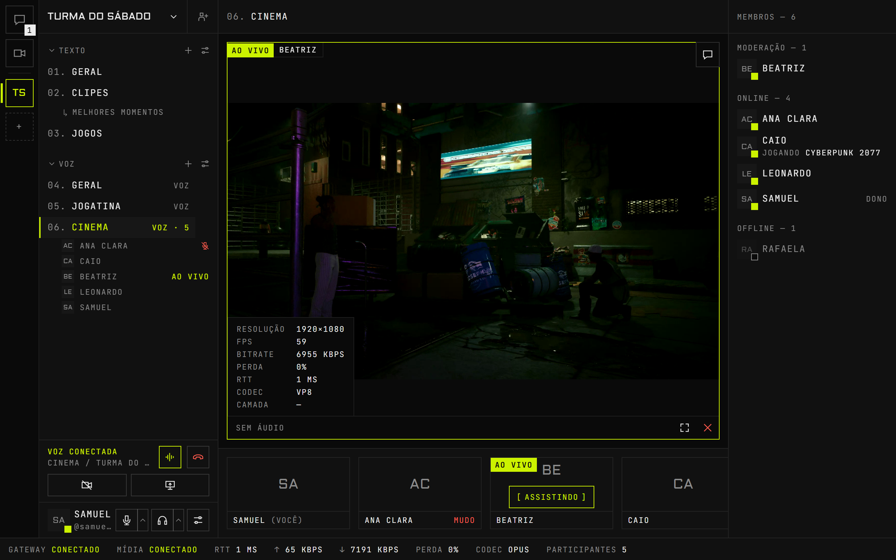

## Sobre o projeto

O Dispeaker nasceu para um grupo de amigos que joga junto e queria se ouvir e se assistir sem depender de ninguém. Ele roda numa VPS própria desde outubro de 2026, no navegador e num app para Windows.

A diferença para um clone de Discord comum está no que fica embaixo da interface. O servidor de mídia é um SFU construído sobre o mediasoup; o gateway em tempo real, o protocolo de sinalização e o motor de captura de tela do app de desktop foram escritos no próprio projeto. É isso que permite transmitir um jogo pesado em tela cheia a 60 quadros por segundo e medir, quadro a quadro, onde uma transmissão perde qualidade.

- Web responsivo e app de desktop para Windows, com a mesma conta e a mesma interface.
- Infraestrutura própria: SFU, gateway WebSocket, TURN, Postgres e Redis, tudo num `docker compose`.
- Cadastro fechado por código de acesso, para servidores só de convidados.
- Interface em português, no estilo "terminal brutalista": painéis com borda de 1px, cantos retos e um único acento.

## Demonstração

<p align="center">
  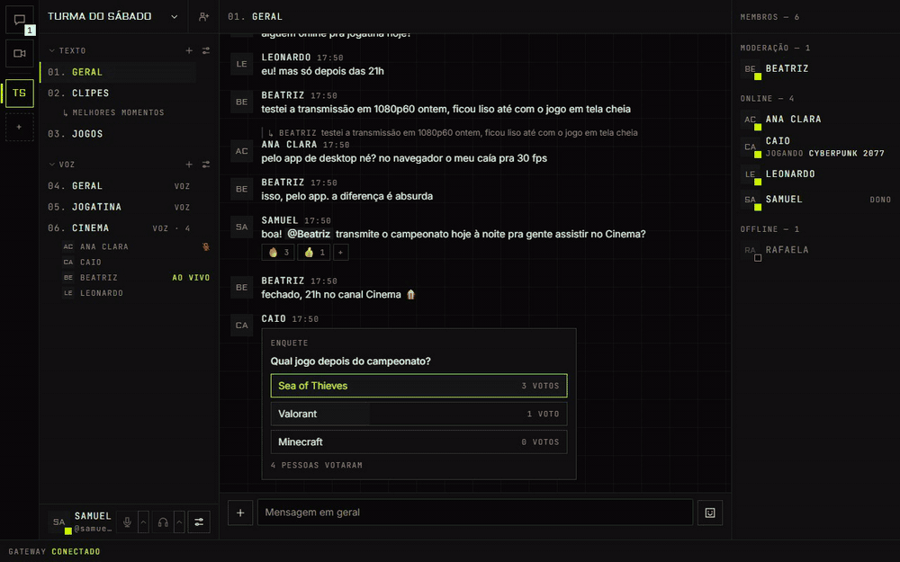
</p>

> Todas as imagens deste README usam contas de demonstração com dados fictícios, rodando no stack local. A chamada, a transmissão e os números são reais; só a câmera, o microfone e a tela são sintéticos.

## Funcionalidades

### Voz e transmissão

<table>
  <tr>
    <td width="50%">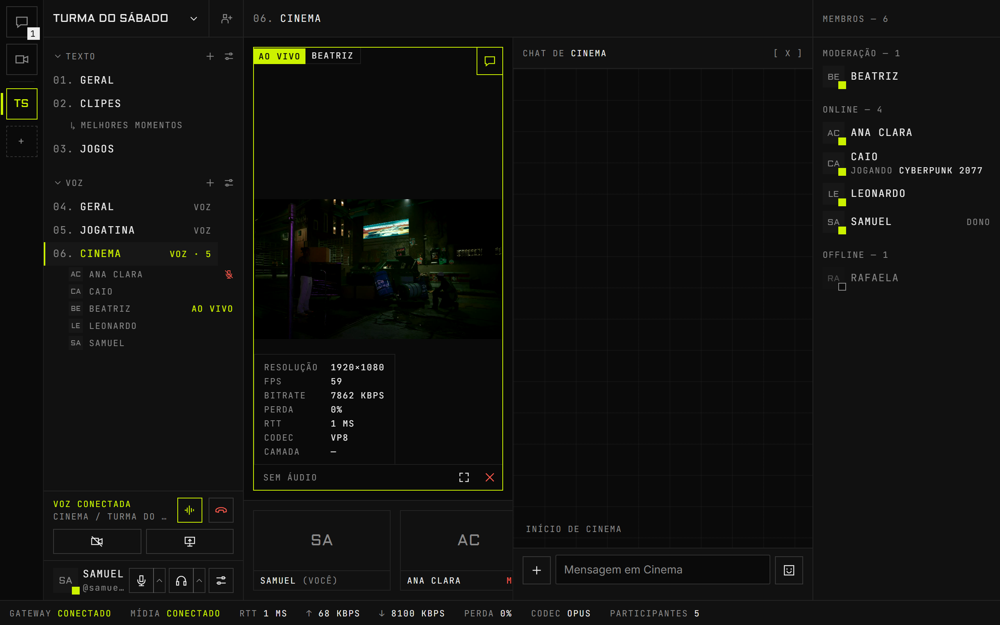</td>
    <td width="50%">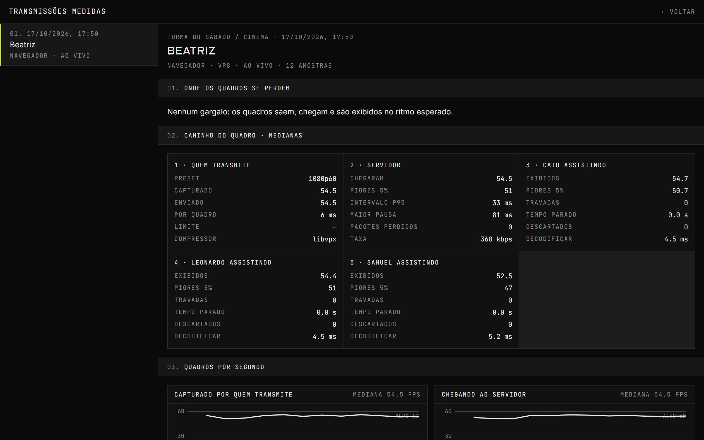</td>
  </tr>
  <tr>
    <td align="center"><sub>Chat ao lado da chamada</sub></td>
    <td align="center"><sub>Medições de uma transmissão</sub></td>
  </tr>
</table>

- **Canais de voz** com mutar, ensurdecer (que de fato para o envio de áudio da chamada, sem calar a transmissão que se assiste), indicador de quem está falando, reconexão automática, apertar para falar e volume individual por pessoa, guardado na conta.
- **Supressão de ruído** por rede neural no navegador (GTCRN em WebAssembly), com um filtro próprio que devolve os agudos que o modelo corta. Voz em Opus a 128 kbps. Cada etapa foi medida contra gravações reais e contra a mesma voz passando pelo Discord.
- **Ouvir como os outros me ouvem**: grava alguns segundos da própria voz com os mesmos filtros e o mesmo Opus de uma chamada, sem precisar de ninguém do outro lado.
- **Transmissão de tela** em H.264 pela placa de vídeo, em três presets (720p30, 1080p60 e 1440p30 para filmes), com som a 256 kbps, várias ao mesmo tempo, tela cheia e janela flutuante.
- **Assistir sob demanda**: o vídeo só vai para quem clicou em assistir, e para de ser enviado quando sai da tela.
- **Estatísticas reais** em cada transmissão (resolução, quadros por segundo, bitrate, perda, codec) e na barra inferior (RTT, envio, recebimento).
- **Transmissões medidas**: quem transmite, o servidor e cada espectador mandam amostras a cada 5 segundos, e a página aponta em que ponto do caminho os quadros se perdem.
- **Vozes medidas**: cada voz de cada chamada é medida em quem fala, no servidor e em quem ouve. Quando alguém soa picotado, a página diz se a falha foi na internet de quem fala (todos ouviram) ou na de um ouvinte só.
- **Sons de eventos** por servidor, inclusive quando alguém abre ou fecha a sua transmissão.
- **Câmera** em simulcast.

### Reuniões por link

<p align="center">
  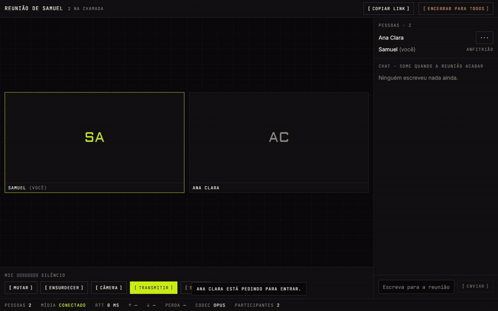
</p>

<table>
  <tr>
    <td width="50%">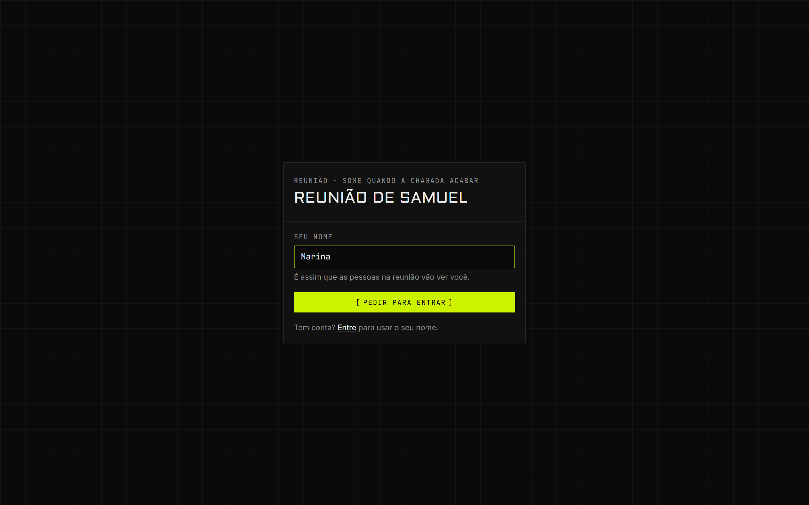</td>
    <td width="50%">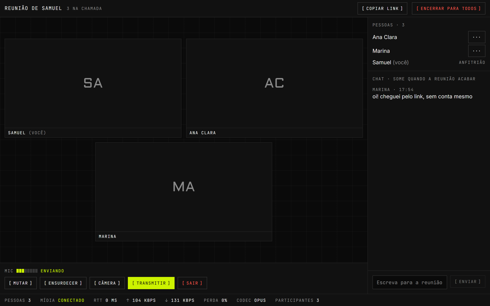</td>
  </tr>
  <tr>
    <td align="center"><sub>Quem chega pelo link</sub></td>
    <td align="center"><sub>Dentro da reunião</sub></td>
  </tr>
</table>

- Uma sala no estilo do Google Meet, fora de qualquer servidor: quem tem o link pede para entrar e quem já está dentro deixa.
- **Convidados sem conta**, só com um nome.
- Voz, câmera, transmissão de tela e chat. O anfitrião muta para todos, remove alguém e encerra.
- A sala vive só no Redis e some, com o chat, dois minutos depois de a chamada esvaziar.

### Chat

<table>
  <tr>
    <td width="50%">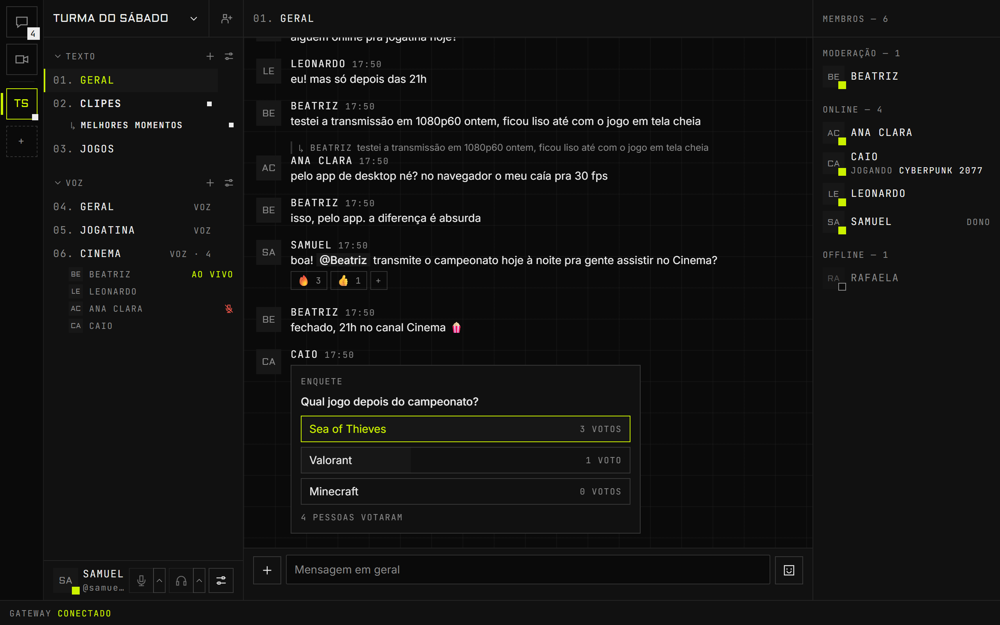</td>
    <td width="50%">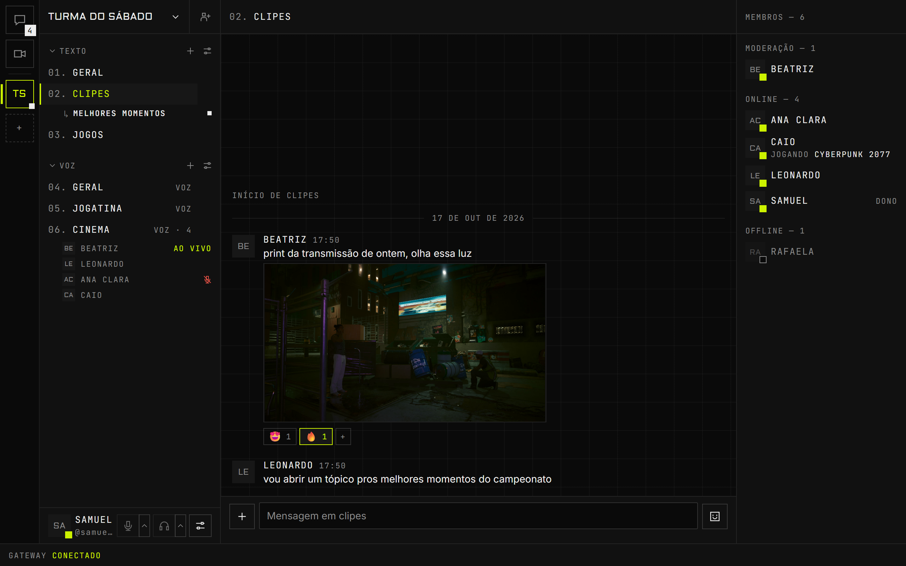</td>
  </tr>
  <tr>
    <td align="center"><sub>Respostas, menções, reações e enquetes</sub></td>
    <td align="center"><sub>Imagens e arquivos</sub></td>
  </tr>
</table>

- Edição, exclusão, menções, respostas, reações, enquetes, **tópicos** e "digitando".
- Imagens coladas, arrastadas ou anexadas; arquivos de qualquer tipo; prévias de links; busca de GIF opcional.
- Anexos servidos com as permissões do canal: quem não vê o canal não abre o arquivo.
- Mensagens não lidas por canal e paginação por cursor.

### Pessoas e servidores

<table>
  <tr>
    <td width="50%">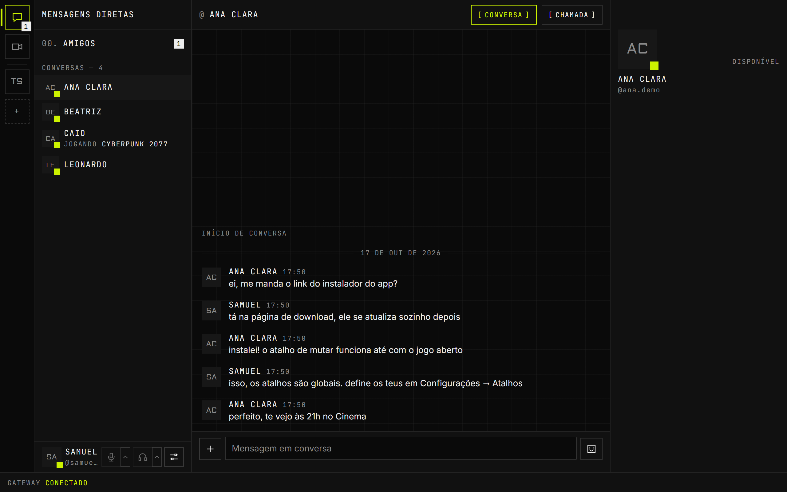</td>
    <td width="50%">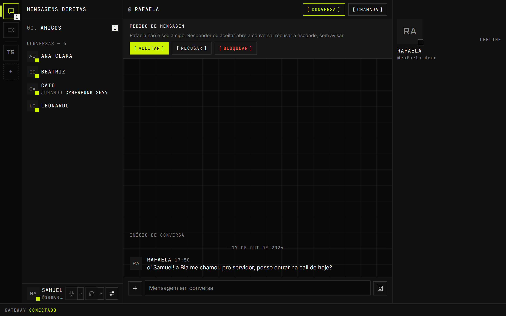</td>
  </tr>
  <tr>
    <td align="center"><sub>Conversas privadas</sub></td>
    <td align="center"><sub>Pedido de mensagem</sub></td>
  </tr>
</table>

- **Amigos, conversas privadas e chamadas a dois**, com toque de chamada recebida.
- **Pedidos de mensagem** de quem divide um servidor mas não é amigo, e **bloqueio**.
- **"Jogando X"** ao lado do nome de quem está com um jogo aberto no app de desktop.
- **Servidores, categorias e canais numerados**, convites com expiração e limite de usos.
- **Cargos e permissões** com hierarquia e sobrescritas por canal, aplicadas no servidor inclusive durante uma chamada: perder a permissão de falar derruba a sessão de voz na hora.
- Preferências (volumes, mudo, privacidade) que acompanham a conta entre aparelhos.

### App de desktop para Windows

<table>
  <tr>
    <td width="50%">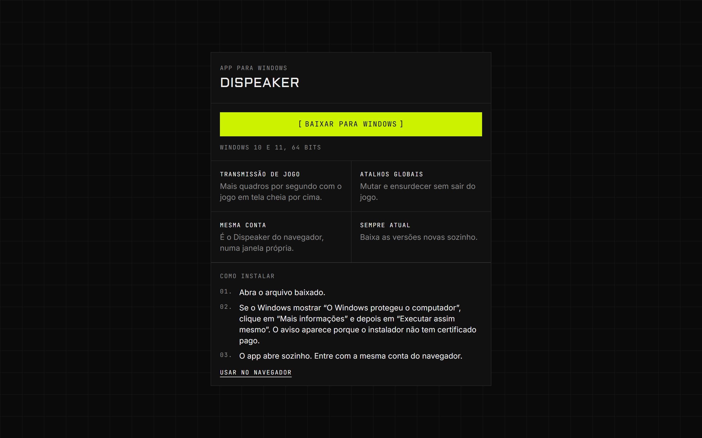</td>
    <td width="50%">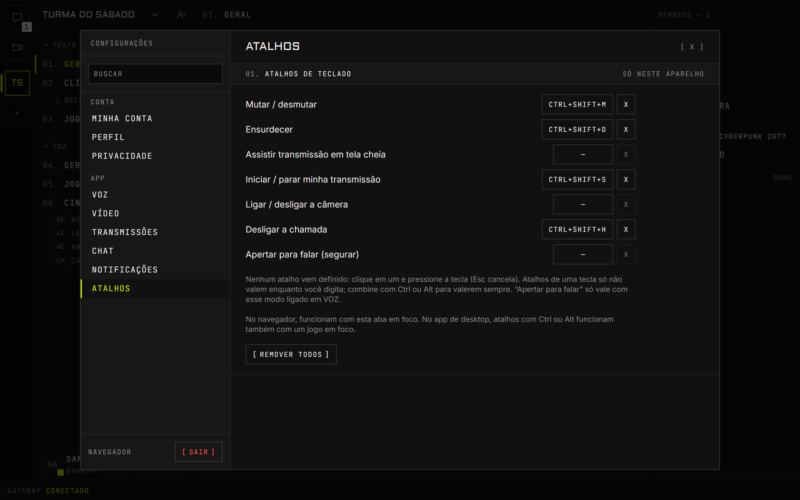</td>
  </tr>
  <tr>
    <td align="center"><sub>Página de download</sub></td>
    <td align="center"><sub>Atalhos globais</sub></td>
  </tr>
</table>

- Uma janela Electron sobre o site publicado: o que o site ganha, o app ganha sem reinstalar.
- **60 fps transmitindo um jogo em tela cheia**, com um motor de captura próprio em Rust (ver [abaixo](#transmitir-um-jogo-a-60-fps)).
- **Atalhos globais** para mutar, ensurdecer, transmitir, câmera e desligar, que funcionam com o jogo em foco. O de transmitir, com um jogo na frente, transmite esse jogo sem abrir o seletor.
- O som da transmissão leva só o jogo, sem o som da chamada nem de outros programas. Quando o jogo não dá para separar, vai o som do PC sem os programas de chamada de voz (Discord incluído); o painel avisa quando a transmissão levaria essas vozes.
- Detecta o jogo aberto (Steam, Epic, Xbox, GOG e programas em tela cheia) sem lista externa e sem internet.
- Botões de microfone, fone e desligar na miniatura da barra de tarefas; ícone na bandeja com o estado da chamada.
- Abre com o Windows, escondido na bandeja (dá para desligar), e o X esconde em vez de fechar: os amigos veem quem está disponível.
- **Avisos no canto da tela**, no estilo da Steam, quando um amigo fica online, entra numa chamada ou começa a transmitir. Um clique leva até lá.
- Atualização automática a partir do próprio servidor.

### No celular

<table>
  <tr>
    <td width="33%">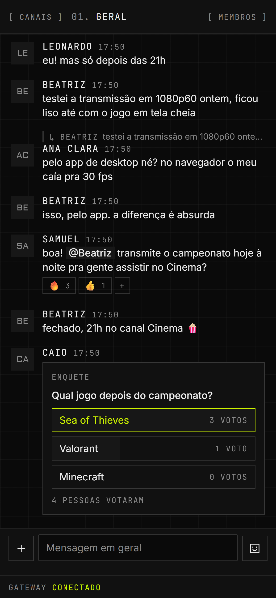</td>
    <td width="33%">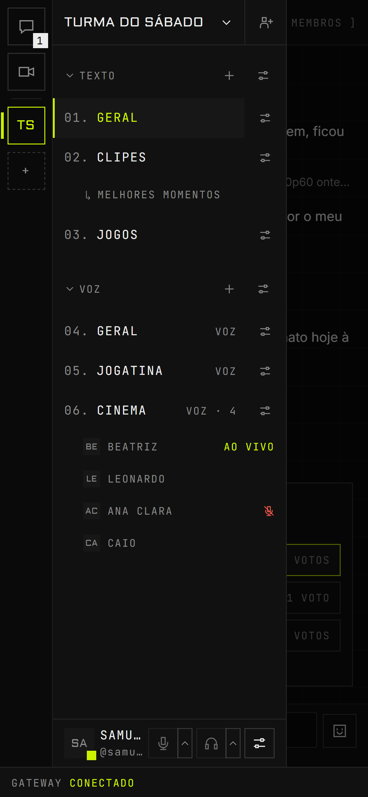</td>
    <td width="33%">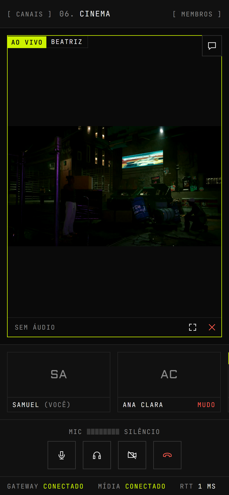</td>
  </tr>
</table>

Canais e membros em gavetas, diálogos em tela cheia, botões de chamada com área de toque de 44px e uma barra de chamada sempre à mão quando se sai do canal de voz.

## Como funciona

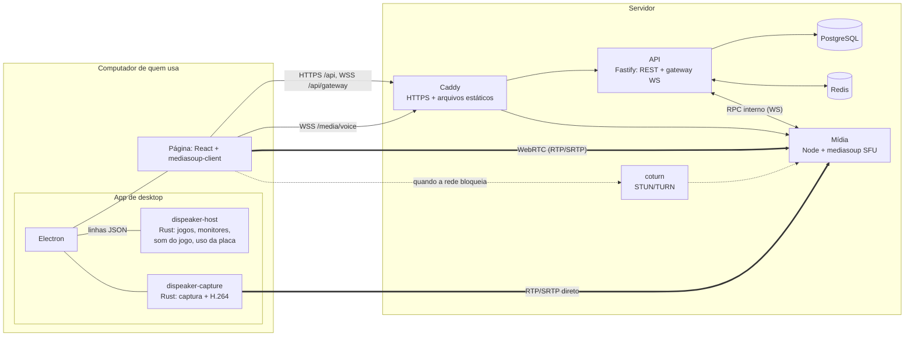

| Serviço        | Faz                                                                            | Não faz                    |
| -------------- | ------------------------------------------------------------------------------ | -------------------------- |
| `apps/web`     | Interface, captura e reprodução de mídia, clientes do gateway e da sinalização | Decidir permissões         |
| `apps/api`     | Contas, servidores, permissões, chat, reuniões, gateway, tokens de voz         | Tocar em mídia             |
| `apps/media`   | SFU: um router por canal, transports, producers, consumers, detecção de fala   | Conhecer usuários ou banco |
| `apps/desktop` | Janela sobre o site, atalhos globais, programas nativos, atualização           | Ter interface própria      |

- **Quem decide é a API.** Para entrar num canal de voz, o navegador pede à API um token de 60 segundos com o que aquela pessoa pode fazer ali (falar, transmitir). O serviço de mídia só confere a assinatura e não sabe o que é um cargo ([ADR 0004](docs/adr/0004-token-de-voz.md)).
- **SFU, não malha ponto a ponto.** Cada pessoa envia sua mídia uma vez para o servidor, que repassa sem decodificar. O upload de quem transmite não cresce com o número de espectadores, e mutar, ensurdecer e tirar permissões valem no servidor, não por boa vontade do cliente ([ADR 0001](docs/adr/0001-sfu-com-mediasoup.md)).
- **Gateway no estilo Discord**: heartbeat, números de sequência e `resume`, que reentrega exatamente o que se perdeu numa queda; eventos atravessam instâncias da API pelo Redis ([ADR 0006](docs/adr/0006-gateway-resume.md)).
- **Tudo que cruza um processo é validado** com um schema Zod de `packages/shared`: corpo HTTP, frame do gateway, RPC interno e o protocolo com os programas nativos. Os tipos saem dos schemas.

### Transmitir um jogo a 60 fps

Chegar a 60 fps com um jogo pesado em tela cheia foi o problema mais difícil do projeto, e cada passo foi decidido pela página de medições:

| Etapa                      | O que limitava                                                                   | Quadros por segundo            |
| -------------------------- | -------------------------------------------------------------------------------- | ------------------------------ |
| Chrome, 3 camadas de vídeo | três camadas dobravam o tempo do codificador da placa (15 + 9 + 6 ms por quadro) | 15 a 24                        |
| Chrome, 1 camada           | o Windows 11 acorda um programa de janela coberta só a cada 15,6 ms              | 26 a 31                        |
| App de desktop             | o app pede ao Windows para sair dessa regra, o que um site não pode              | 45 a 51                        |
| App com o motor em Rust    | captura e compressão fora do Chromium: 5 ms por quadro na placa                  | **60**, p95 do intervalo 19 ms |

Medido numa RX 7800 XT com Cyberpunk 2077 em 1080p60. O motor (`apps/desktop/native/capture`) captura pela Desktop Duplication, converte para NV12 na placa, comprime em H.264 pelo Media Foundation e manda RTP/SRTP direto ao SFU, reenviando pacotes perdidos e ajustando o bitrate pela perda ([ADR 0013](docs/adr/0013-motor-de-transmissao-nativo.md)).

## Tecnologias Utilizadas

| Camada   | Ferramentas                                                               |
| -------- | ------------------------------------------------------------------------- |
| Web      | React 19, Vite, Tailwind CSS 4, mediasoup-client, TanStack Query, Zustand |
| API      | Fastify 5, WebSocket, Zod, OpenAPI (`/docs`), Drizzle ORM                 |
| Mídia    | Node, mediasoup 3 (workers em C++)                                        |
| Desktop  | Electron; Rust com DXGI, Direct3D 11, Media Foundation e WASAPI           |
| Dados    | PostgreSQL, Redis (presença, estado de voz, reuniões, pub/sub)            |
| Voz      | GTCRN e RNNoise em WebAssembly, AudioWorklet próprio                      |
| Testes   | Vitest, Playwright (inclusive do app Electron), k6                        |
| Infra    | Docker Compose, Caddy (HTTPS automático), coturn, GitHub Actions          |
| Monorepo | pnpm workspaces, Turborepo, TypeScript `strict`                           |

## Instalação

### Pré-requisitos

- Node.js 22.12 ou superior
- pnpm 11
- Docker é opcional: sem ele, o projeto sobe um Postgres e um Redis embutidos.

### Passos

1. **Clone o repositório e instale as dependências**

```bash
git clone https://github.com/SamuelSousaDEV/Dispeak.git
cd Dispeak
pnpm install
```

2. **Suba o stack de desenvolvimento**

```bash
pnpm dev        # http://localhost:5173
```

O comando sobe Postgres e Redis, aplica as migrations e inicia web (5173), API (4000) e mídia (4100, mais as portas RTC a partir de 40000). Nenhuma configuração é obrigatória; cada app tem um `.env.example` comentado.

3. **Experimente**

Abra duas janelas (uma anônima), crie duas contas, crie um servidor, gere um convite e entre no canal de voz com as duas. Para testar de um celular na mesma rede, use `DEV_HTTPS=1 pnpm dev` e abra `https://<ip-da-máquina>:5173` (o navegador só libera o microfone em conexão segura).

### Produção

Com Docker e um `.env.prod` preenchido, `pnpm prod:up` sobe Caddy, API, mídia, Postgres, Redis e coturn. Passo a passo, portas e firewall em [docs/deploy.md](docs/deploy.md). Com `REGISTRATION_CODE` definido, o cadastro pede um código de acesso.

## Scripts Disponíveis

```bash
pnpm dev                    # Stack completo em desenvolvimento
pnpm dev:docker             # Igual, com o serviço de mídia em container
pnpm check                  # Lint + formatação + typecheck + testes
pnpm test                   # Testes unitários e de integração
pnpm e2e                    # Testes ponta a ponta (sobe o stack sozinho)
pnpm build && pnpm start:local   # Builds de produção, localmente
pnpm prod:up                # Produção com Docker
pnpm release:desktop        # Gera o instalador do app e envia ao servidor
```

## Estrutura do Projeto

```
apps/
├── web/        # React: features/{voice,streams,meetings,chat,friends,guilds,gateway,desktop}, e2e/
├── api/        # Fastify: modules/{auth,guilds,messages,voice,meetings,streams,voice-reports,friends}, gateway/, db/
├── media/      # mediasoup: rooms/{room,peer,room-manager}, signaling/
└── desktop/    # Electron: janela, seletor de tela, atalhos, atualização
    └── native/ # capture/ e host/ em Rust
packages/
└── shared/     # Schemas Zod: RPC, sinalização, gateway, REST, permissões, processo nativo
deploy/         # Caddyfile
docs/           # Arquitetura, deploy, teste de carga, ADRs
load/           # Scripts k6 e resultados brutos
scripts/        # Orquestração de dev, produção local, build nativo e lançamento
```

## Testes

```
pnpm test    482 testes   permissões, protocolo RPC, API com Postgres e Redis reais,
                          SFU com workers mediasoup reais, estado do cliente
pnpm e2e      19 testes   Chromium com câmera, microfone e tela sintéticos;
                          o app de desktop com o motor de captura de verdade
```

Os testes de integração não usam mocks de infraestrutura. Alguns que valem a leitura:

- [`apps/media/test/voice.test.ts`](apps/media/test/voice.test.ts) pergunta ao próprio worker do mediasoup se sobrou algum router ou transport depois que todos saem do canal.
- [`apps/api/test/gateway.test.ts`](apps/api/test/gateway.test.ts) derruba conexões e confere que o `resume` reentrega exatamente o que foi perdido, com duas instâncias da API.
- [`apps/web/e2e/app.spec.ts`](apps/web/e2e/app.spec.ts) percorre criar conta, servidor, convite, voz e transmissão, e tira permissões no meio da chamada.
- [`apps/web/e2e/ingest.spec.ts`](apps/web/e2e/ingest.spec.ts) transmite pelo motor nativo e assiste de um navegador com e sem placa de vídeo.

### Teste de carga

Builds de produção numa única máquina (Ryzen 7 5700G), detalhes em [docs/load-test.md](docs/load-test.md):

| Cenário                                     | Resultado                                         |
| ------------------------------------------- | ------------------------------------------------- |
| API, 200 usuários virtuais                  | 168 req/s, p95 de 34 ms, 0% de erros              |
| Gateway, 500 conexões num servidor          | entrega com p95 de 26 ms, 6,5 mil eventos/s       |
| Voz + tela, 24 pessoas, 1 transmissão 1080p | 391 consumers, worker do mediasoup em 0,58 núcleo |

## Limitações conhecidas

- Uma instância do serviço de mídia; um canal de voz vive num núcleo (dezenas de pessoas cabem, centenas não).
- O motor de captura foi validado em placas AMD; NVIDIA e Intel usam o mesmo caminho, mas ainda não foram testadas.
- App de desktop só para Windows e sem assinatura de código, então o Windows avisa na primeira instalação.
- Sem gravação e sem conversas privadas em grupo.

O que ainda depende de validação manual está no [ROADMAP](ROADMAP.md).

## Imagens deste README

As imagens são geradas por um roteiro, contra o stack local e com dados fictícios:

```bash
pnpm dev
STREAM_IMAGE=<caminho de uma .jpg> pnpm --filter @frequencia/web readme:seed
STREAM_IMAGE=<a mesma imagem>  pnpm --filter @frequencia/web readme:shots
```

`STREAM_IMAGE` é o que a conta de demonstração transmite. Os arquivos saem em `docs/readme/`.

## Licença

Todos os direitos reservados. Veja [LICENSE](LICENSE).

## Autor

- **Samuel Sousa**: [github.com/SamuelSousaDEV](https://github.com/SamuelSousaDEV)
